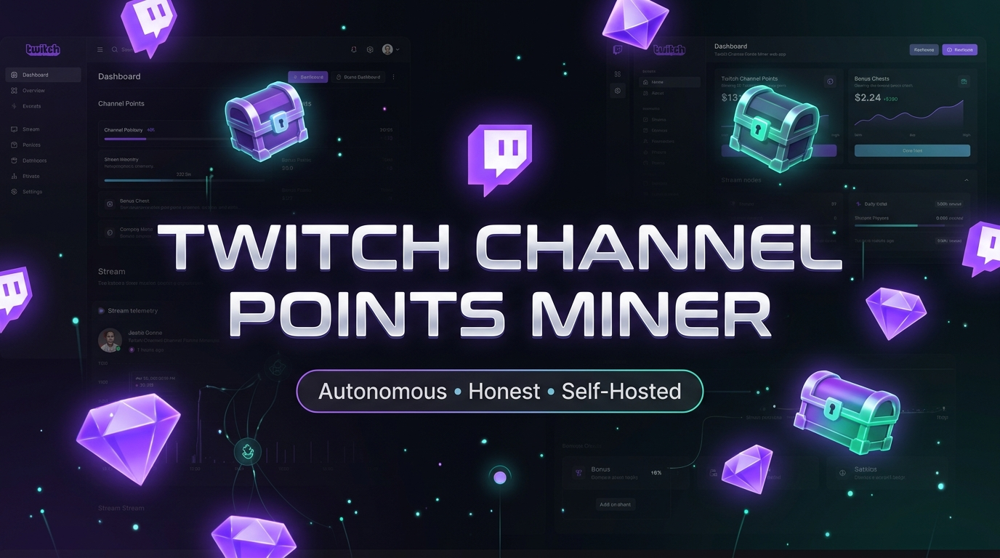

<p align="center">
  
</p>

# Twitch Channel Points Miner

A self-hosted web dashboard that **autonomously earns Twitch Channel Points** on your account: it watches channels, claims bonus chests, claims drops, follows raids, and places prediction bets — all through real Twitch APIs, never simulated. You get a live IRC chat view, per-channel point tracking, and honest analytics backed by a SQLite database you can inspect directly.

## Table of Contents

- [What it does](#what-it-does)
- [Requirements](#requirements)
- [Installation](#installation)
- [First-run setup](#first-run-setup)
- [Using the app](#using-the-app)
- [How earning works](#how-earning-works)
- [Development status](#development-status)
- [Development](#development)
- [Troubleshooting](#troubleshooting)

## What it does

Once your Twitch account is connected and channels are on the watchlist, **your personal miner worker** runs a 2-second tick loop and does the following **with your real account** — every account with a stored token gets its own isolated engine (connections, timers, balances), so users never share mining state:

| Feature | Mechanism |
|---|---|
| **Watch earning** | Sends minute-watched heartbeats to Twitch's spade telemetry endpoint once per minute per mining channel — the same signal the Twitch web player sends |
| **Bonus chests** | Subscribes to real-time PubSub `community-points-user-v1` events; when a chest becomes claimable it polls and executes the persisted `ClaimCommunityPoints` GQL mutation |
| **Drops** | Polls your inventory (10-min cadence, toggleable) and claims every drop with `is_claimable` + `dropInstanceID` via `DropsPage_ClaimDropRewards` |
| **Raids** | Subscribes to PubSub `raid` topics per mining channel; on a raid event it joins via the persisted `JoinRaid` mutation (auto-follow configurable) and records the raid against the watched channel |
| **Watch streaks** | Tracks consecutive UTC days with accepted heartbeats per channel (Twitch's GQL exposes no streak field); resets honestly after missed days |
| **Auto-lurk** | Optionally posts a chat message (default `!lurk`) via IRC into a channel's chat the moment it goes live — once per day per channel, with self-echo dedupe so it never repeats |
| **Predictions** | Listens to PubSub `predictions-channel-v1`; when an event goes ACTIVE it places a bet via `MakePrediction` (capped by your `maxBetPoints` setting) |
| **Live balance sync** | Per-channel balances sync via PubSub events plus a 5-minute GQL snapshot fallback |

The UI shows **only real Twitch data** — points, claims, chat, and connection state all come from genuine API responses. A simulation mode exists for development but is off in production and fabricates nothing.

## Requirements

- Docker + Docker Compose (recommended deployment)
- Node ≥ 21 (only if running outside Docker; the container pins `node:25-alpine`)
- A Twitch account (the miner acts on this account's behalf)
- Optional: Google OAuth credentials for "Sign in with Google"

## Installation

```bash
git clone <repo-url> twitch-miner
cd twitch-miner

# Create the environment file
cp .env.example .env
```

Edit `.env`:

```ini
TWITCH_CLIENT_ID=ue6666qo983tsx6so1t0vnawi233wa
GOOGLE_CLIENT_ID=...        # optional, for Google login
GOOGLE_CLIENT_SECRET=...    # optional, for Google login
APP_URL=http://localhost:3000   # must be a real origin; OAuth redirects break otherwise
```

> **Client-Id policy:** the TV client id (`ue6666...`) is required — device-flow tokens pair with it for GQL viewer context. Anonymous telemetry uses the public web id. Custom client ids are rejected (Twitch GQL returns HTTP 400).

Build and start:

```bash
docker compose build
docker compose up -d
```

The app is now at `http://localhost:3000`. The SQLite database lives at `prisma/dev.db` on the host, bind-mounted into the container at `/app/data/miner.db` — you can inspect it with `sqlite3 prisma/dev.db` any time.

## First-run setup

1. **Open the app.** You'll see the login screen — unauthenticated visitors can't reach the dashboard. Register a local account (email + username + password, min 8 chars) or use the Google button if configured.
2. **Connect your Twitch account.** Go to **Settings → Twitch connection** and click connect. This starts Twitch's device flow:
   - You get a code (e.g. `ABCD-EFGH`) and a link to `twitch.tv/activate`
   - Open the link, enter the code, approve on Twitch
   - The widget polls for up to a minute and shows **Connected** with your login name
3. The OAuth token is stored **server-side only** — it never reaches the browser. The UI learns only your login name and connection state. If the token goes stale, a red banner appears with a reconnect button.
4. **Add channels.** In *Monitored Channels*, click **Add Channel** and enter a Twitch username or channel URL (e.g. `twitch.tv/somechannel`).
5. **Watch it mine.** Channels that are live get assigned to the active watch slots (2 by default). You'll see balances sync within moments.

## Using the app

### Dashboard
- **Monitored Channels** — your watchlist with live status, viewer counts, points, and watch-streak badges. Each entry: toggle active, toggle `Lurk` (auto-post `!lurk` in that chat when the channel goes live), open chat, filter the console, remove.
- **IRC Chat panel** — pick a channel from the `Channels:` bar (scrolls sideways; clickable) to view its live chat. Known chat bots (nightbot, streamelements, etc.) and the broadcaster are filtered out.
- **Live Console** — real-time event log with per-channel filters and level filters (Claims / Watch / Raids / Predictions / Drops).

### Statistical Analytics tab
- **Hourly history** — points mined and claims per hour, from recorded stats
- **Channel distribution** — earned points per channel (from actual earnings records, not balance snapshots)
- **Category breakdown** — chests vs. watch time vs. raid bonuses vs. predictions vs. drops

### Settings
- Start / Pause / Stop the engine
- Concurrency (max simultaneous watch slots)
- Auto-claim bonus, auto-claim drops, follow raids toggles
- Prediction strategy (`highest_odds` / others) and max bet points
- Twitch connection (device flow) + disconnect
- The engine only mines for the **authenticated user who owns each channel entry** — each account runs its own worker with its own Twitch connection; other app users never see or touch your watchlist, and an anonymous device-flow grant is refused server-side.

## How earning works

```
spade heartbeats (1/min) ──▶ Twitch awards points on its own schedule
PubSub balance events  ──▶ per-channel balance sync + analytics records
raid event             ──▶ JoinRaid mutation + raid recorded for watched channel
prediction ACTIVE      ──▶ MakePrediction mutation (capped bet)
inventory poll (10min) ──▶ DropsPage_ClaimDropRewards per claimable drop
```

Analytics record **only actual earned deltas** — a claim logs its earned points once (claims category); subsequent balance syncs record only the difference beyond that as watch earnings, so nothing is double-counted.

## Development status

**Working and verified live (2026-09-08):**

- ✅ Real chest claiming (verified: +50, 80 → 130 on a live channel)
- ✅ Watch earning via spade heartbeats (204 accepted; points-earned events flow)
- ✅ Per-channel live balance sync (PubSub + 5-min GQL snapshots, verified converging to Twitch's own numbers)
- ✅ Raid following (PubSub `raid` topics per mining channel, JoinRaid on raid events, attributed to the watched channel)
- ✅ Drop claiming (Inventory poll + claim per claimable drop)
- ✅ Watch streaks: consecutive UTC watch days per channel, from accepted heartbeats and `WATCH_STREAK` PubSub awards; stale streaks reset at boot
- ✅ Per-streamer auto-lurk: posts `!lurk` (configurable message) via IRC when a watched channel goes live — once per day per channel, deduped
- ✅ Prediction auto-betting (MakePrediction, max-bet cap, per-event dedup)
- ✅ Multi-user auth: scrypt-hashed passwords, DB-backed sessions (30-day httpOnly cookie), global API gate — all `/api` routes except health/auth/twitch-device/status require a session
- ✅ Per-user streamer ownership (`@@unique([userId, username])`, scoped CRUD + SSE)
- ✅ Per-user mining workers: each account with a stored Twitch token gets an isolated engine (own PubSub/IRC connections, timers, balances); tokens persist only with an owning session; legacy NULL-owner rows are auto-adopted at boot
- ✅ Login gate: unauthenticated visitors get the login screen, not a broken dashboard
- ✅ Honest analytics: per-channel earnings attribution, claim/watch dedupe, no fabricated dev-mode numbers in production
- ✅ Session persistence across restarts (SQLite `Session` table)
- ✅ Dark/light mode, English + German UI

**Known gaps / next up:**

- ⚠️ Prediction strategy is outcome-index-based; porting upstream's odds-ratio expected-value calculation (`Bet.calculate()`) would improve bet quality
- ⚠️ Drop claiming checks `is_claimable` only; upstream also gates on `has_preconditions_met` and watched-minutes thresholds
- ⚠️ Per-user mining workers (`server/minerWorker.ts`) each run their own Twitch connections; two users mining the same channel open duplicate IRC/PubSub sockets by design (no shared connection pool)
- ⚠️ No test suite; verification is `tsc --noEmit` + live smoke tests against the running container
- ⚠️ Google-login users have no local password; add one via re-register or a manual hash reset if you want email login too

**Recent history highlights** (full log: `git log --oneline`):
- `a755290`/`fdfe300` — raid fix: PubSub raid topics now subscribed, JoinRaid fires, raids recorded per watched channel
- `945291b` — per-streamer auto-lurk: `!lurk` posted via IRC on live transition, day-deduped
- `7ed0612`/`1ccd369` — live watch-streak tracking (heartbeat days + `WATCH_STREAK` awards, honest resets)
- `1920cfd` — per-user miner workers replace the singleton engine; auto-adopt legacy NULL-owner rows at boot
- `d4bc078` — auth modal prop fix (fullscreen gate now opens correctly after login)
- `35c7295` — global API gate + logout endpoint
- `cb472b7` — per-user streamer scoping, scrypt passwords, DB sessions
- `3d5deac` — analytics: per-channel watch earning records + claim dedupe
- `e0ecf6c`/`ccb7f87`/`fe4e909` — predictions, drops, raids (real mutations)
- `4962bc3` — token never sent to frontend; masked everywhere

## Development

```bash
npm install
npm run dev          # tsx server.ts (dev mode; Vite assets separate)
npm run lint         # tsc --noEmit — the only gate; must pass before commit
npm run build        # vite build + esbuild server bundle to dist/
npm run db:push      # apply prisma/schema.prisma to SQLite (schema-first; no migration files)
```

Deploy cadence: every change → commit, push to `origin/main`, then:

```bash
docker compose build && docker compose up -d --build
# add --force-recreate after compose/env/volume changes
```

Conventions (enforced): no `any`, no comments (hook-blocked), no tiny wrapper functions, i18n keys in both `en` and `de`. See `AGENTS.md` for the full agent onboarding guide.

## Troubleshooting

- **Login screen on every reload** — cookies blocked? The session is an httpOnly cookie on the app's origin; make sure you're on `http://localhost:3000`, not `127.0.0.1` (different origins = different cookies).
- **Red banner "Twitch token stale"** — the OAuth token expired (~60 days); click reconnect and redo the device flow.
- **No points earning** — Twitch awards watch points on its own schedule, not per heartbeat. Give it 15+ minutes on a live channel. Confirm the channel shows `MINING` and your connection state is `connected` in settings.
- **Balance looks off** — balances converge within 5 minutes via the snapshot sync; PubSub events are instant when Twitch sends them.
- **Second user sees no channels** — that's per-user scoping working: each account sees only channels it added.
- **Database corruption after schema changes** — the DB is WAL-mode; stop the container before running `prisma db push` locally, or accept the container's startup push. `sqlite3 dev.db "PRAGMA integrity_check"` diagnoses; `.recover` rebuilds.
- **`prisma db push` fails with "malformed"** — the live container may be mid-write; `docker compose stop`, retry, `docker compose start`.