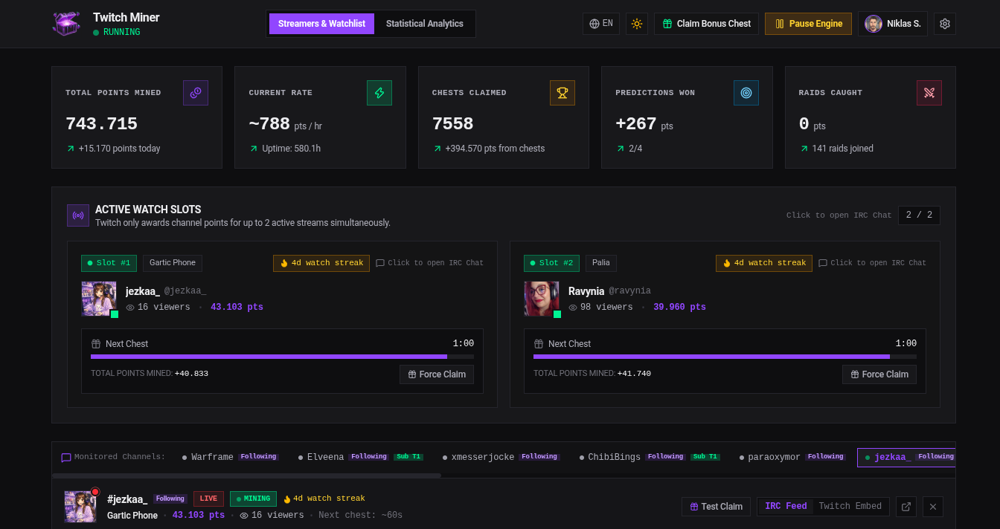

<p align="center">
  
</p>

# Twitch Channel Points Miner

A self-hosted web dashboard that **autonomously earns Twitch Channel Points** on your account: it watches channels, claims bonus chests, claims drops, follows raids, and places prediction bets — all through real Twitch APIs, never simulated. You get a live IRC chat view, per-channel point tracking, and honest analytics backed by a SQLite database you can inspect directly.

<p align="center">
  
</p>

> **Built for Unraid.** This project is designed specifically to be deployed as a Docker container on an Unraid server: a ready-made [Unraid template](docs/unraid/twitch-channel-miner.xml) installs it from the Docker tab, its data lives in `appdata`, and the [`:latest-node` image](#two-runtimes-bun-and-node) exists so it also runs on older Unraid hardware without AVX2. Setup steps: [Deployment examples → Unraid](docs/deployment.md#unraid). Plain Docker Compose works too.

## Table of Contents

- [What it does](#what-it-does)
- [Requirements](#requirements)
- [Two runtimes: Bun and Node](#two-runtimes-bun-and-node)
- [Installation](#installation)
- [Deployment examples (Docker Compose, Unraid)](docs/deployment.md)
- [First-run setup](#first-run-setup)
- [Using the app](#using-the-app)
- [How earning works](#how-earning-works)
- [Security](#security)
- [Development status](#development-status)
- [Development](#development)
- [Troubleshooting](#troubleshooting)
- [License](#license)

## What it does

Once your Twitch account is connected and channels are on the watchlist, **your personal miner worker** runs a 2-second tick loop and does the following **with your real account**. Every account with a stored token gets its own isolated engine (connections, timers, balances), so users never share mining state.

| Feature               | Mechanism                                                                                                                                                                                                                                                                                                                                                      |
| --------------------- | -------------------------------------------------------------------------------------------------------------------------------------------------------------------------------------------------------------------------------------------------------------------------------------------------------------------------------------------------------------- |
| **Watch earning**     | Sends minute-watched heartbeats to Twitch's spade telemetry endpoint once per minute per mining channel — the same signal the Twitch web player sends                                                                                                                                                                                                          |
| **Bonus chests**      | Claims a chest via the `ClaimCommunityPoints` GQL mutation as soon as PubSub reports it (`claim-available`), with a 30-second polling fallback. Only channels with channel points enabled (read from Twitch's `communityPointsSettings.isEnabled`) are claimed; other channels show "Bonus chests are not supported on this channel" instead of a progress bar |
| **Drops**             | Polls your inventory (10-min cadence, toggleable) and claims every unclaimed drop whose watched minutes meet the requirement (and whose preconditions are met) via `DropsPage_ClaimDropRewards` with its `dropInstanceID`                                                                                                                                      |
| **Raids**             | Subscribes to PubSub `raid.{channelId}` topics for the channels currently mining; on a raid it joins via the persisted `JoinRaid` mutation (auto-follow configurable) and records the raid once against the watched channel. Raid bonus points come from `RAID` point gains, never an assumed amount                                                           |
| **Predictions**       | Listens to PubSub `predictions-channel-v1`. When an event goes ACTIVE (and auto-bet is on) the bet is **scheduled shortly before the prediction locks** — at 60% of the window or 10 s before lock, whichever is later — so the strategy decides on real pool data. It then places a bet via `MakePrediction`; results arrive via `predictions-user-v1`        |
| **Watch streaks**     | Tracks consecutive UTC days with accepted heartbeats per channel (Twitch's GQL exposes no streak field); resets honestly after missed days                                                                                                                                                                                                                     |
| **Auto-lurk**         | Optionally posts a chat message (default `!lurk`) via IRC into a channel's chat the moment it goes live — once per day per channel, with self-echo dedupe so it never repeats                                                                                                                                                                                  |
| **Live balance sync** | Per-channel balances sync via PubSub events plus a 5-minute GQL snapshot fallback                                                                                                                                                                                                                                                                              |
| **Token health**      | If Twitch rejects the stored token (401 / `ERR_BADAUTH`), authenticated work pauses with a single warning instead of retrying forever; the token is re-validated every 5 minutes and mining resumes on its own once it's valid again                                                                                                                           |

Connections are per-user by necessity: every IRC and PubSub socket authenticates with that account's own Twitch token, so two users mining the same channel each open their own — there is no shared connection pool, and there cannot be one. An IRC socket carries a single identity (`PASS oauth:…` / `NICK …`), which is what auto-lurk posts under and what the self-echo dedupe matches against; `community-points-user-v1` and `predictions-user-v1` are keyed to the account anyway; and PubSub `MESSAGE` frames identify only the topic, so two accounts listening to the same channel topic on one socket would produce indistinguishable events. The cost is small: one PubSub socket per user, plus at most two mining IRC sockets and any chat-view sockets, which close after 10 idle minutes.

PubSub subscriptions follow the active watch slots: when a channel starts or stops mining, its `raid`, `predictions-channel-v1`, and `community-points-channel-v1` topics are subscribed or unsubscribed on the open socket (capped at Twitch's 50 topics per connection). Twitch `RECONNECT` messages are honored, and reconnects use exponential backoff.

The dashboard shows **only real Twitch data** — points, claims, chat, and connection state all come from genuine Twitch API responses. No simulation mode exists; nothing displayed is fabricated.

## Requirements

- Docker + Docker Compose (recommended deployment)
- Modern x86-64 CPU with AVX2 for the default Bun image — or any CPU with the Node image (`:latest-node`); see [Two runtimes](#two-runtimes-bun-and-node)
- A Twitch account (the miner acts on this account's behalf)
- Optional: Google OAuth credentials for "Sign in with Google"

## Two runtimes: Bun and Node

The project ships **two Docker images** for every release, so it runs on both modern and older hardware:

|                | Bun image                                                   | Node image                                                                       |
| -------------- | ----------------------------------------------------------- | -------------------------------------------------------------------------------- |
| **Dockerfile** | `Dockerfile` (`oven/bun:1`)                                 | `Dockerfile.node` (`node:25-alpine`)                                             |
| **GHCR tags**  | `:latest`, `:1.x.x`, `:v1.x.x`, `:sha-<commit>`             | `:latest-node`, `:1.x.x-node`, `:v1.x.x-node`, `:sha-<commit>-node`              |
| **Hardware**   | Modern x86-64 with **AVX2** (Bun's baseline requirement)    | Any x86-64 (and ARM) — no AVX2 needed                                            |
| **Why**        | Bun starts faster and bundles the WebSocket client natively | Node ≥ 22 also has native `WebSocket`, so the same esbuild bundle runs unchanged |

**Which one do I need?** If your CPU supports AVX2 (2013+ Intel Haswell, AMD Excavator+, basically anything modern), use the default Bun image (`:latest`). If your server crashes with `Illegal instruction` on startup — typical for older AMD hardware like the Turion II Neo in older Unraid boxes, which lacks AVX2 entirely — use the Node image (`:latest-node`). Check with:

```bash
grep -q avx2 /proc/cpuinfo && echo "Bun image OK" || echo "Use the :latest-node image"
```

To run the Node image, override the image in your `docker-compose.yaml`:

```yaml
services:
  twitch-miner:
    image: ghcr.io/niklasschaeffer/twitch-channel-miner-v3:latest-node
```

Both images run the exact same application code (`dist/server.cjs`), database, and features — only the JavaScript runtime differs. The images contain only the built app and `prisma/schema.prisma`; no database or `.env` file is ever baked in. On every start the container runs `prisma db push` (with the pinned Prisma CLI) to apply the schema to your database — a change that would drop data is refused instead of applied, so the container won't start until you've dealt with it (see [Troubleshooting](#troubleshooting)).

## Installation

> **Just want to run it?** Use a prebuilt image: [`docs/deployment.md`](docs/deployment.md) has a ready-made [Docker Compose file](docs/docker-compose.example.yaml) and an [Unraid template](docs/unraid/twitch-channel-miner.xml). The steps below build the image from source.

```bash
git clone <repo-url> twitch-miner
cd twitch-miner
cp .env.example .env
```

Edit `.env`:

```ini
TWITCH_CLIENT_ID=ue6666qo983tsx6so1t0vnawi233wa
GOOGLE_CLIENT_ID=
GOOGLE_CLIENT_SECRET=
APP_URL=http://localhost:3000
ALLOW_REGISTRATION=false
```

| Variable                                    | Purpose                                                                                                                                                                                                      |
| ------------------------------------------- | ------------------------------------------------------------------------------------------------------------------------------------------------------------------------------------------------------------ |
| `TWITCH_CLIENT_ID`                          | Must be the TV client id shown above (see the Client-Id policy below)                                                                                                                                        |
| `GOOGLE_CLIENT_ID` / `GOOGLE_CLIENT_SECRET` | Optional — enables "Sign in with Google". Redirect URI: `<APP_URL>/api/auth/google/callback`                                                                                                                 |
| `APP_URL`                                   | The origin the app is served from. Must be a real origin, or OAuth redirects break. If it starts with `https://`, the session cookie is marked `Secure`                                                      |
| `ALLOW_REGISTRATION`                        | Optional, defaults to closed. The **first** account on an empty database can always register; after that, new accounts (local or Google) need `ALLOW_REGISTRATION=true`. Existing accounts can always log in |

> **Client-Id policy:** `TWITCH_CLIENT_ID` must be the TV client id `ue6666qo983tsx6so1t0vnawi233wa` — device-flow tokens pair with it for GQL viewer context. Anonymous telemetry uses the public web id. **Do not use the client id of an app you registered at dev.twitch.tv:** Twitch's internal GQL API only accepts tokens minted under its first-party client ids, so such a token still passes `/oauth2/validate` but every authenticated GQL call (chests, drops, watch heartbeats, balance) fails with `401 The "Authorization" token is invalid`. After changing the id, recreate the container and reconnect Twitch in the settings.

Build and start:

```bash
docker compose build
docker compose up -d
```

The app is now at `http://localhost:3000`. The SQLite database lives at `prisma/dev.db` on the host, bind-mounted into the container at `/app/data/miner.db`. The WAL sidecar files (`-wal`/`-shm`) exist only inside the container, so **stop the container before reading or copying `prisma/dev.db` on the host** — otherwise you see stale data, and writing to it can corrupt it.

## First-run setup

1. **Open the app.** You'll see the login screen — unauthenticated visitors can't reach the dashboard. Register the first account (email + username + password, min 8 characters) or use the Google button if configured. Once an account exists, the Register tab is hidden unless `ALLOW_REGISTRATION=true`.
2. **Connect your Twitch account.** Go to **Settings → Twitch Account** and click connect. This starts Twitch's device flow:
   - You get a code (e.g. `ABCD-EFGH`) and a link to `twitch.tv/activate`
   - Open the link, enter the code, approve on Twitch
   - The widget polls for up to a minute and shows **Connected** with your login name
3. The OAuth token is stored **server-side only** — it never reaches the browser. The UI learns only your login name and connection state. If the token stops working, a red banner stays at the top of the page with a reconnect button until you re-pair.
4. **Add channels.** In _Monitored Channels_, click **Add Channel** and enter a Twitch username or channel URL (e.g. `twitch.tv/somechannel`).
5. **Watch it mine.** Channels that are live get assigned to the active watch slots (2 by default). You'll see balances sync within moments.

## Using the app

### Dashboard

- **Active Watch Slots** — the channels currently mining, with bonus-chest progress and a claim button. Channels without channel points show that bonus chests aren't supported there instead.
- **Monitored Channels** — your watchlist with live status, viewer counts, points, and watch-streak badges. Each entry: toggle active, toggle `Lurk` (auto-post `!lurk` in that chat when the channel goes live), change priority, open chat, filter the console, remove. The footer shows used vs. configured slots.
- **IRC Chat panel** — pick a channel from the `Channels:` bar (scrolls sideways; clickable) to view its live chat. Known chat bots (nightbot, streamelements, etc.) and the broadcaster are filtered out. Chat connections opened just for viewing are closed after 10 idle minutes.
- **Live Console** — real-time event log with per-channel filters and level filters (Claims / Watch / Raids / Predictions / Drops).

The dashboard updates live over Server-Sent Events; it only falls back to polling while that connection is down.

### Statistical Analytics tab

- **Hourly history** — points mined and claims per hour, from recorded stats
- **Channel distribution** — earned points per channel (from actual earnings records, not balance snapshots)
- **Category breakdown** — chests vs. watch time vs. raid bonuses vs. predictions
- **Drop campaigns** — campaigns in progress with per-drop watched/required minutes, straight from your Twitch inventory
- **Claimed drops** — rewards awarded to your Twitch account in the last 30 days (including ones claimed outside the miner)

### Settings

- Start / Pause / Stop the engine
- Concurrency: 1–2 simultaneous watch slots (Twitch only credits two streams at a time)
- Auto-claim bonus (with a 1–15 s claim delay), auto-claim drops, follow raids toggles
- Prediction strategy and max bet points (at least 10, Twitch's minimum bet):

  | Strategy       | Picks                                                                                       |
  | -------------- | ------------------------------------------------------------------------------------------- |
  | `smart_ratio`  | The outcome most users chose when the crowd is clearly split (≥ 20% gap), else the underdog |
  | `conservative` | The outcome most users chose; bets 5% of the balance instead of 10%                         |
  | `lowest_odds`  | The favorite (largest points pool)                                                          |
  | `highest_odds` | The underdog (smallest points pool)                                                         |

  A bet is 10% of the channel balance (5% for `conservative`), raised to Twitch's 10-point minimum and capped by max bet points and the balance itself; channels with fewer than 10 points get no bet. Rejected bets retry up to 3 times.

- Twitch connection (device flow) + disconnect
- The engine only mines for the **authenticated user who owns each channel entry** — each account runs its own worker with its own Twitch connection; other app users never see or touch your watchlist.

Settings are validated server-side: unknown fields are dropped and numbers are clamped to the ranges above.

## How earning works

```
spade heartbeats (1/min)   ──▶ Twitch awards points on its own schedule
PubSub balance events      ──▶ per-channel balance sync + analytics records
raid event                 ──▶ JoinRaid mutation + raid recorded once for the watched channel
prediction ACTIVE          ──▶ bet scheduled near lock ──▶ MakePrediction with fresh pool data
inventory poll (10 min)    ──▶ DropsPage_ClaimDropRewards per claimable drop
```

Analytics record **only actual earned deltas** — a claim logs its earned points once (claims category); subsequent balance syncs record only the difference beyond that as watch earnings, so nothing is double-counted.

## Security

- **Registration** is closed after the first account unless `ALLOW_REGISTRATION=true`.
- **Sessions** are random 256-bit ids stored in the SQLite `Session` table and sent as an `HttpOnly`, `SameSite=Lax` cookie (plus `Secure` when `APP_URL` is `https://`); they expire after 30 days. Every `/api` route except health, auth, the Twitch device flow, and status requires a session.
- **Passwords** are hashed with scrypt and a per-user salt; login takes the same time whether or not the email exists.
- **Rate limits:** 5 failed logins per email or 50 per IP within 15 minutes lock logins for 15 minutes; registration is capped at 5 attempts per IP per hour. Both answer `429` with a `Retry-After` header.
- **Google sign-in** requires a verified Google email. If it matches an existing account that has a password, Google is treated as proof of ownership: the password is removed and all existing sessions of that account are signed out.
- **The Twitch token** stays on the server; the browser only ever sees `hasAuthToken`.
- **Input** for settings and streamer updates is validated; stats like points or live status can only come from Twitch, never from an API request.
- **Docker images** contain no database or environment files.

## Development status

**Working and verified live (last checked 2026-09-11):**

- ✅ Real chest claiming (verified: +50, 80 → 130 on a live channel), skipped on channels without channel points
- ✅ Watch earning via spade heartbeats (204 accepted; points-earned events flow)
- ✅ Per-channel live balance sync (PubSub + 5-min GQL snapshots, verified converging to Twitch's own numbers)
- ✅ PubSub topics subscribed right after boot and kept in sync with the active slots
- ✅ Raid following (JoinRaid on raid events, attributed to the watched channel, deduped)
- ✅ Drop claiming (Inventory poll + claim per claimable drop)
- ✅ Watch streaks: consecutive UTC watch days per channel, from accepted heartbeats and `WATCH_STREAK` PubSub awards; stale streaks reset at boot
- ✅ Per-streamer auto-lurk: posts `!lurk` (configurable message) via IRC when a watched channel goes live — once per day per channel, deduped
- ✅ Prediction auto-betting with results tracking (won / lost / net points)
- ✅ Multi-user auth: scrypt passwords, DB-backed sessions, global API gate, closed registration, rate-limited login
- ✅ Per-user streamer ownership (`@@unique([userId, username])`, scoped CRUD + SSE)
- ✅ Per-user mining workers: each account with a stored Twitch token gets an isolated engine (own PubSub/IRC connections, timers, balances); legacy NULL-owner rows are auto-adopted at boot
- ✅ Honest analytics: per-channel earnings attribution, claim/watch dedupe, no fabricated numbers
- ✅ Dark/light mode, English + German UI (every visible string translated)

**Shipped but not yet observed on a live event:**

- 🔎 Prediction bets placed near lock time (covered by unit tests; waiting for a live prediction to confirm)
- 🔎 Automatic pause and recovery when Twitch revokes the token

**Known gaps / next up:**

- ⚠️ The per-IP login limit sees every client behind Docker's port forwarding or a reverse proxy as the same address (no `trust proxy` configured), so the per-email limit is what protects individual accounts
- ⚠️ The container runs as root; switching users needs care because `prisma/dev.db` is bind-mounted from the host
- ⚠️ Google-login users have no local password; a Google sign-in on an email that has one removes it (by design, see [Security](#security))

**Recent history highlights** (full log: `git log --oneline`, release notes: `CHANGELOG.md`):

- `358b501` — chest progress hidden on channels without channel points (1.23.1)
- `c6ffd45` — closed registration, login rate limits, Google account-linking fix, crash-proof cookie parsing (1.23.0)
- `51413e5`/`913e81d` — PubSub topics kept in sync with slots, bets near prediction lock, revoked-token pause and recovery
- `dbaded1` — persistent token banner, SSE-first polling, full en/de translations
- `d9d80b8`/`a722706` — no database files in images, pinned Prisma CLI, stale migrations removed
- `c9b4f3d` — prediction results and real raid points from PubSub
- `ba9c504`/`7b7a371` — drop claiming and drop campaign analytics
- `1062cb6` — unified settings with the Twitch account section; simulation mode removed entirely
- `1920cfd` — per-user miner workers replace the singleton engine
- `cb472b7` — per-user streamer scoping, scrypt passwords, DB sessions

## Development

Run the app **only through Docker**. Running `npm run dev` or `node`/`bun` on the host while the container is up opens the same bind-mounted `prisma/dev.db` from a second process and can corrupt it.

```bash
bun install
npm run lint
npm run test
npm run build
```

| Command           | What it does                                                                                                                            |
| ----------------- | --------------------------------------------------------------------------------------------------------------------------------------- |
| `npm run lint`    | `tsc --noEmit` — must pass before every commit                                                                                          |
| `npm run test`    | Vitest suite in `tests/` (pure logic: chest, predictions, PubSub, validation, rate limits, i18n parity) — must pass before every commit |
| `npm run build`   | Vite frontend build + esbuild bundle of `server.ts` to `dist/server.cjs`                                                                |
| `npm run db:push` | Apply `prisma/schema.prisma` to SQLite (schema-first, no migration files) — **stop the container first**                                |

A husky pre-commit hook runs `oxlint`, `oxfmt`, and `npm run lint`. Releases are fully automated by semantic-release on `main`, so commit messages must follow Conventional Commits (`feat:`, `fix:`, …); never hand-edit `CHANGELOG.md` or the version in `package.json`.

Deploy cadence: every change → commit, push to `origin/main`, then:

```bash
docker compose build && docker compose up -d --build
```

Add `--force-recreate` after changes to the compose file or `.env`.

Conventions (enforced): no `any`, no comments (hook-blocked), no tiny wrapper functions, i18n keys in both `en` and `de`. See `AGENTS.md` for the full agent onboarding guide.

## Troubleshooting

- **Login screen on every reload** — cookies blocked? The session is an httpOnly cookie on the app's origin; make sure you're on `http://localhost:3000`, not `127.0.0.1` (different origins = different cookies). If `APP_URL` is `https://…`, the cookie is `Secure` and won't be sent over plain `http://`.
- **"Registration is closed"** — an account already exists. Set `ALLOW_REGISTRATION=true` in `.env` and run `docker compose up -d --force-recreate`, or sign in with an existing account.
- **"Too many login attempts"** — 5 failed logins for that email (or 50 from your IP) in 15 minutes. Wait for the time shown, then try again.
- **Red banner "Twitch token stale"** — Twitch rejected the token (it expired or was revoked). Mining of points, chests, drops, and bets pauses; click reconnect and redo the device flow. If it was a temporary Twitch error, the miner recovers on its own within 5 minutes.
- **"Bonus chests are not supported on this channel"** — the channel has channel points turned off (or isn't a partner/affiliate), so there are no chests to claim. Watch time still counts toward streaks.
- **No points earning** — Twitch awards watch points on its own schedule, not per heartbeat. Give it 15+ minutes on a live channel. Confirm the channel shows `MINING` and your connection state is `connected` in settings.
- **Balance looks off** — balances converge within 5 minutes via the snapshot sync; PubSub events are instant when Twitch sends them.
- **Second user sees no channels** — that's per-user scoping working: each account sees only channels it added.
- **My password stopped working after using Google** — signing in with Google on an email that had a password removes that password on purpose. Keep using Google for that account.
- **Container keeps restarting after an update** — check `docker compose logs`: if `prisma db push` refuses a change that would drop data, the container won't start. Stop it, back up `prisma/dev.db`, then decide whether to apply the change manually (`npm run db:push` with the container stopped) or roll back.
- **Database corruption** — the DB is in WAL mode; never run `prisma db push` or copy `prisma/dev.db` while the container is running. `sqlite3 prisma/dev.db "PRAGMA integrity_check"` diagnoses; `.recover` rebuilds.
- **`prisma db push` fails with "malformed"** — the live container may be mid-write; `docker compose stop`, retry, `docker compose start`.

## License

[MIT](LICENSE) © 2026 Niklas Schäffer
